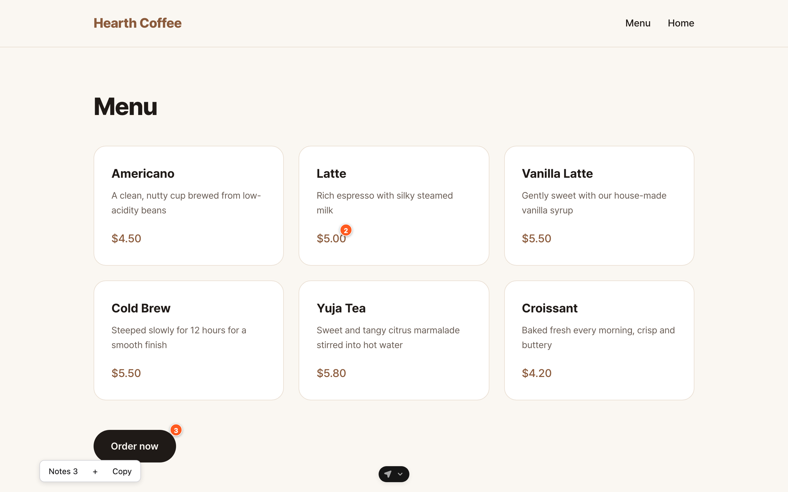
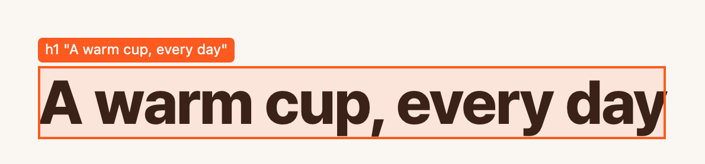
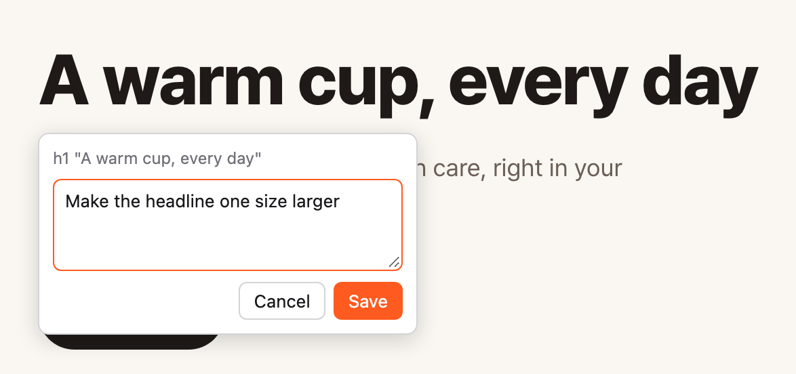
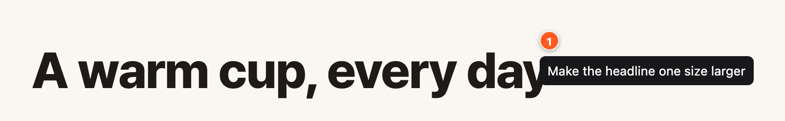
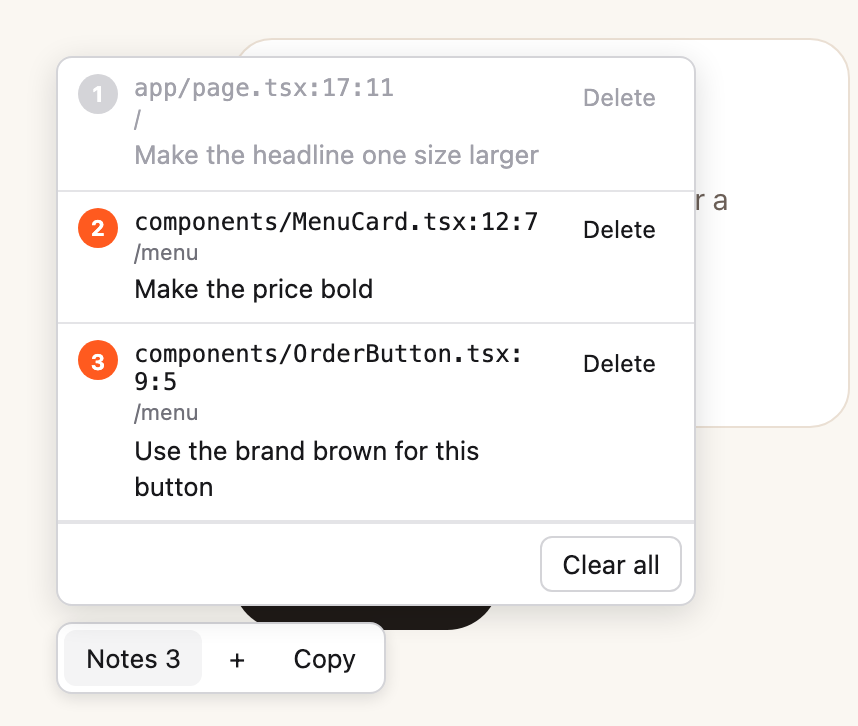
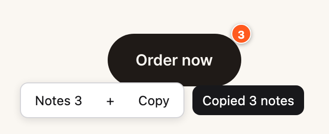

# pinprompt

**Point at your running UI, leave notes, and hand them to your coding agent as one prompt.**



Describing UI changes in words is slow and vague ("the price on the second card…"). With pinprompt you click the element, type what should change, and keep going. Notes stay on screen as numbered pins, survive page navigation, and one **Copy** turns them into a list your agent can act on, each line with the exact source location:

```
1. app/page.tsx:17:11 (h1 "A warm cup, every day") — Make the headline one size larger
2. components/MenuCard.tsx:12:7 (strong "$5.00") — Make the price bold
3. components/OrderButton.tsx:9:5 (button "Order now") — Use the brand brown for this button
```

Paste it into Claude Code, Codex, Cursor, or any agent that takes text.

## Usage

A printable version of these steps is in [docs/usage-flow.pdf](docs/usage-flow.pdf).

**1. Click `+` (bottom-left) and hover the element you want to change.**
Or press <kbd>Alt</kbd>+<kbd>Shift</kbd>+<kbd>P</kbd>. While picking, clicks don't trigger your app's links or buttons. <kbd>Esc</kbd> cancels.



**2. Click it and type a note.**
<kbd>Enter</kbd> saves, <kbd>Shift</kbd>+<kbd>Enter</kbd> adds a line, <kbd>Esc</kbd> cancels.



**3. A numbered pin stays on the element.**
Hover it to preview the note, click it to edit or delete.



**4. Keep going on other pages.**
Notes persist across navigation and reloads. Pins only show on the page where you left them, and `Notes N` lists everything.



**5. Click `Copy` and paste into your agent.**



## Install

Requirements: Node.js 20+ and a React app on **Next.js (App Router)** or **Vite**.

```bash
git clone https://github.com/sjk0503/pinprompt.git
cd pinprompt
npm link              # makes the `pinprompt` command available globally
```

Then, in your app:

```bash
cd path/to/your-app
pinprompt install
npm run dev
```

`pinprompt install` does the following, and prints every file it changed:

- Adds [React Grab](https://github.com/aidenybai/react-grab) if it's missing. It resolves each element to its source file and line.
- Creates `public/__dev/pinprompt.js`, a symlink to this repo's `src/pinprompt.js`, so pulling a new version of pinprompt updates every app at once. Use `--copy` if symlinks are a problem.
- Writes `public/__dev/pinprompt.config.json` with the project root, used to print project-relative paths.
- Adds `public/__dev/` to `.gitignore`.
- Inserts a dev-only loader into your root layout (Next.js) or entry file (Vite), between `pinprompt:start` and `pinprompt:end` comments. Running it again is safe.

Nothing ships to production: the loader only runs in development and the files are git-ignored.

<details>
<summary>Example output</summary>

```
pinprompt install: ~/my-app (Next.js App Router)
React Grab: already installed.

Changed files:
  - public/__dev/pinprompt.js (symlink -> ~/pinprompt/src/pinprompt.js)
  - public/__dev/pinprompt.config.json
  - .gitignore
  - app/layout.tsx

Use: start your dev server -> click + (bottom-left) -> click an element -> type a note, Enter -> Copy
Remove: pinprompt uninstall
```

</details>

To remove it (React Grab is left in place):

```bash
pinprompt uninstall
```

## Copy format

One note per line, numbered like the pins on screen:

```
N. <file>:<line>:<column> (<tag> "<text>") — <note>
```

- **Location** is the source position reported by React Grab, relative to your project root. If there is no source location (a non-React page, or React Grab is missing), it falls back to `<route> <css selector>`.
- **`(tag "text")`** tells apart elements rendered from the same line, such as items of a `.map()` list.
- Line breaks inside a note become ` / ` so every note stays on one line.

## How it works

- One dependency-free script. Its UI lives in a Shadow DOM, so your app's CSS and pinprompt's CSS never mix.
- Notes are kept in `localStorage` (`pinprompt:v1`), per browser and per origin.
- Source locations come from React Grab's `getSource`, which reads React's owner stacks and source maps. It works with Server Components and Turbopack.
- React Grab returns absolute paths for client components; pinprompt rewrites them relative to the root in `pinprompt.config.json`.
- The full behavior spec is in [SPEC.md](SPEC.md).

## Limitations

- `file:line:column` needs React (through React Grab). Other frameworks still work, with selector locations.
- Line numbers drift once the code changes. Clear your notes (`Notes N` → `Clear all`) after your agent has applied them.
- Notes don't sync across browsers or machines.

## Development

```bash
npm install
npm test            # Playwright tests for the overlay, then node:test for the installer
```

## License

[MIT](LICENSE)
